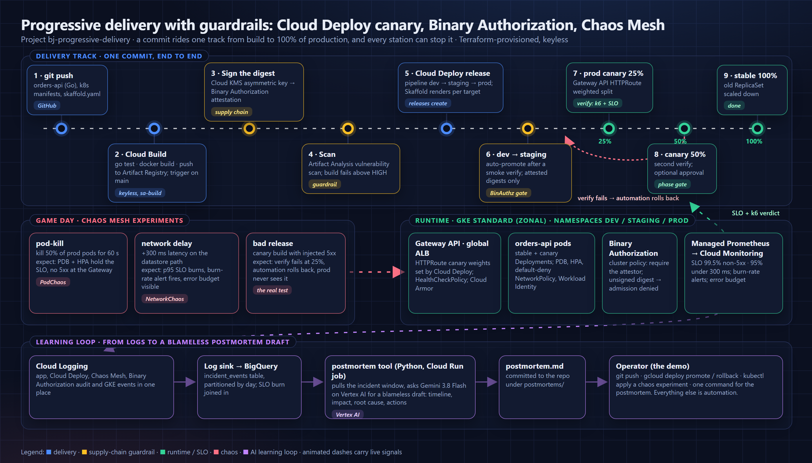

# Progressive delivery with guardrails: Cloud Deploy canary, Binary Authorization, Chaos Mesh

[](demo/demo.mp4)

A commit rides one track from build to 100% of production, and every station can stop it. **GitHub Actions**
builds `orders-api` (Go), pushes it by digest, **signs the digest with Cloud KMS** and records a **Binary
Authorization** attestation, then creates a **Cloud Deploy** release. Cloud Deploy promotes it **dev → staging →
prod** with an in-cluster **verify job** at every stage; prod is a **canary on Gateway API traffic splitting
(25% → 50% → 100%)**; an **automation** advances the phases and **rolls back** when verification fails. The
cluster **admits only attested images**. **Chaos Mesh** game days (pod-kill, network delay) and a deliberately
**bad release** (`FAIL_RATE=0.5`) prove the guardrails. Every incident leaves logs in **BigQuery** through a log
sink, and a small tool asks **Gemini** for a blameless **postmortem draft** from that evidence. Terraform for
every resource; keyless from CI to pod.

- Demo video: [`demo/demo.mp4`](demo/demo.mp4) · captions [`demo/captions.srt`](demo/captions.srt) · transcript [`demo/transcript.md`](demo/transcript.md)
- Docs site: [`docs/index.html`](docs/index.html) · game days: [`chaos/README.md`](chaos/README.md) · postmortems: [`postmortems/`](postmortems/)
- Project: `bj-progressive-delivery` · zone `us-central1-a`
- **Rebuild from scratch, step by step (incl. first signed release, CI secret, teardown): [`REBUILD.md`](REBUILD.md)**

## The track

| Station | What happens | Where |
|---|---|---|
| 1 push | `app/` (Go), `k8s/`, `skaffold.yaml` | GitHub |
| 2 build | `go test`, `docker build`, push; the **digest** is the identity from here on | `.github/workflows/release.yml` |
| 3 sign | `gcloud beta container binauthz attestations sign-and-create` with the KMS key version (EC P-256) | workflow · `terraform/binauthz.tf` |
| 4 scan | Artifact Analysis scans on push (vulnerability occurrences next to the attestation) | `terraform/apis.tf` |
| 5 release | `gcloud deploy releases create … --images orders-api=<digest> --deploy-parameters FAIL_RATE=…` | workflow · `deploy.sh release` |
| 6 dev → staging | standard strategy + **verify** (in-cluster Job: 80 POSTs, ≤1 failure, p95 ≤ 300 ms); automation promotes after 60 s | `skaffold.yaml` · `terraform/clouddeploy.tf` |
| 7-8 prod canary | Cloud Deploy creates `orders-api-canary`, sets HTTPRoute weights 25% then 50%, verifies the **canary Service** at each phase | same |
| 9 stable | 100%, canary resources removed; a failed verify triggers the **repair rule: rollback** | same |

**Binary Authorization** (`PROJECT_SINGLETON_POLICY_ENFORCE`): default rule *require attestation by
`delivery-ci-attestor`*, enforcement *block and audit log*; GKE system images, Chaos Mesh, `curlimages/curl` and
`grafana/k6` are allow-listed by pattern. `kubectl run nginx` in prod is denied; the denial is an audit log entry
that ends up in BigQuery.

## Game days (`chaos/`)

| Experiment | Expect |
|---|---|
| `pod-kill.yaml`: kill 50% of prod pods | PDB + HPA keep serving; Gateway health check drops dead backends in ~10 s; availability SLO unchanged |
| `network-delay.yaml`: +300 ms to Firestore for 2 min | p95 > 300 ms; latency SLO burns; fast-burn alert; availability green |
| bad release: `./deploy.sh release bad1 0.5` or the workflow input | verify fails (dev, or prod at 25%); automation rolls back; stable pods never run it |

## Learning loop (`postmortem/`)

`terraform/logging.tf` routes app logs, Cloud Deploy and Binary Authorization audit entries, Kubernetes events and
Chaos Mesh logs into the BigQuery dataset `incidents` (partitioned tables). `postmortem/postmortem.py --last 30m
--title "…"` pulls that window plus prod 5xx ratio / p95 / ready pods from the Cloud Monitoring PromQL API and asks
`gemini-3.8-flash` for a structured, blameless draft (summary, impact, timeline, detection, root cause, action
items). The facts come from the logs; the prose from the model; a human edits before it counts.

## Repository layout

```
app/                 Go service + tests, distroless Dockerfile; FAIL_RATE / EXTRA_LATENCY_MS fault knobs (business routes only)
k8s/common/          deployment (from-param placeholders), service, hpa, pdb, networkpolicy, podmonitoring, serviceaccount
k8s/namespaces/      dev/staging/prod namespaces (Pod Security restricted), applied by deploy.sh, not by releases
k8s/envs/<env>/      per-target extras; prod adds Gateway + HTTPRoute + HealthCheckPolicy
skaffold.yaml        rawYaml per profile, kubectl deployer, in-cluster verify Job (curl-based checks)
terraform/           apis, vpc(+NAT), gke (Standard zonal, BinAuthz enforce, Dataplane V2, WI, GMP, Gateway API), registry+firestore,
                     binauthz (KMS key, note, attestor, policy), clouddeploy (3 targets, pipeline, automation), iam (app, deploy,
                     CI via WIF, build, postmortem), logging (sink → BigQuery), monitoring (2 SLOs, burn alerts, dashboard), outputs
chaos/               Chaos Mesh experiments + README
postmortem/          postmortem.py (BigQuery + PromQL + Gemini), Dockerfile for a Cloud Run job
.github/workflows/   release.yml: test → build → sign → attest → release (keyless), workflow_dispatch for the bad release
deploy.sh            terraform → kubeconfig → Chaos Mesh → first signed release → wait for prod   (release | slo modes)
smoke.sh             prod through the Gateway, releases/rollouts, Binary Authorization denial, attestation, Chaos Mesh health
teardown.sh          namespaces + chaos → terraform destroy → LB leftovers + buckets → destroy again → audit
demo/                recorder.py + scenes.py (narrated screencast)
docs/                architecture (animated HTML + PNG), docs site
```

## Deploy

```bash
cp terraform/terraform.tfvars.example terraform/terraform.tfvars
./deploy.sh                                     # ~25 min to a prod rollout; first apply reports the SLOs as "Cannot find metric"
./smoke.sh && ./deploy.sh slo                   # traffic, then the second apply creates the SLOs and alerts
kubectl apply -f chaos/pod-kill.yaml            # game day 1
./deploy.sh release bad1 0.5                    # the bad release: watch verify fail and the rollback happen
python postmortem/postmortem.py --last 30m --title "bad release caught by canary verify"
```

See [`REBUILD.md`](REBUILD.md) for the CI secret, the org-policy override and the teardown.

## Design notes (interview talking points)

- **Digest, not tag.** The release pins `orders-api@sha256:…`; the attestation is on the digest; the admission controller checks the digest. A re-pushed tag changes nothing.
- **Verify where the traffic is.** The verify Job runs inside the cluster and prefers the canary Service, so a bad canary fails at 25% with 75% of users untouched. The gates are the SLOs restated (error rate, p95).
- **Automation rules are policy.** Promote after a wait, advance phases after a wait, repair = rollback. Humans can still `gcloud deploy rollouts approve`, but the default path needs nobody awake.
- **Fault knobs never touch probes.** A bad release looks healthy to kubelet (liveness/readiness pass) and only fails real requests: that is why verification and SLOs exist, and why "the pods are Running" is not a deploy signal.
- **Kustomize strips comments.** Cloud Deploy's `# from-param` substitution needs the comment in the rendered manifest, so this repo renders raw YAML per profile; target-level parameters carry `APP_ENV` and `REPLICAS`, release-level ones carry the fault knobs.
- **Chaos on Standard, not Autopilot.** Chaos Mesh's daemon is privileged; Autopilot refuses it. Zonal Standard also keeps the management fee at zero.
- **Postmortems from evidence.** The model sees only the window's logs and metrics and is told to say when evidence is missing; the draft is checked in next to the code that caused it.

## Cost and cleanup

Zonal Standard cluster (free tier management), 2-4 e2-standard-2 nodes, one global LB, NAT, KMS (cents), Cloud
Deploy (first pipeline free), BigQuery/Logging within free tiers: roughly ₹400-500 per day. `./teardown.sh` removes
it; `./audit-billing.sh` should print empty sections.

## How I built this

Code, Terraform and the demo pipeline were written with Claude Code and verified against the real project: the
pipeline promoted real releases, the canary verification failed a real bad release and rolled it back, Binary
Authorization denied a real unsigned pod, the chaos experiments ran against prod, and the postmortem drafts in
`postmortems/` were generated from the logs those events left behind.
